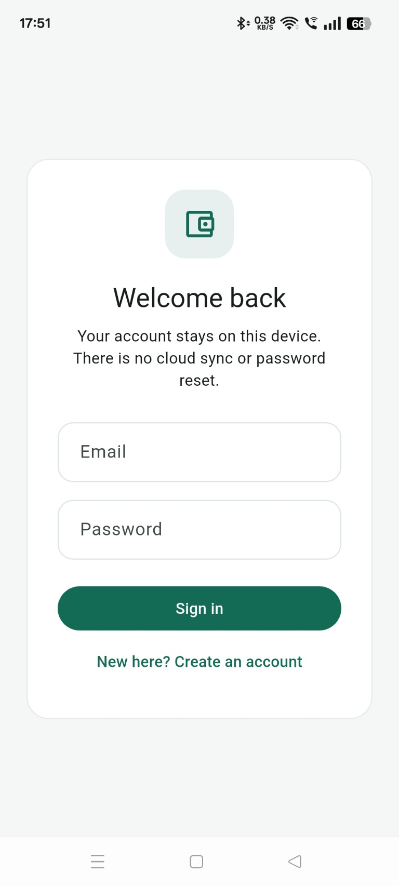
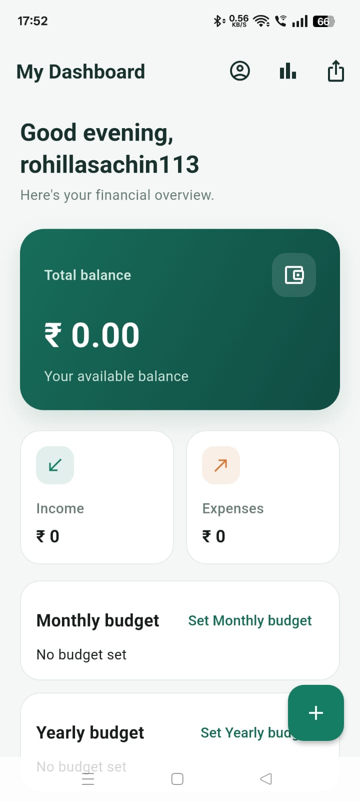
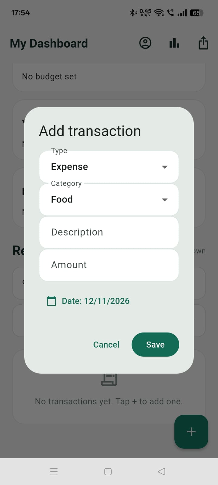

# Expense Tracker

A Flutter expense tracker for recording income and expenses in Indian rupees.

## Screenshots

| Sign in | Dashboard | Add transaction |
| --- | --- | --- |
|  |  |  |

## Features

- Add, edit, and delete transactions with a category and date.
- Keep transactions and the monthly spending budget on this device between launches.
- View income, expenses, and balance totals calculated from saved transactions.
- Search and sort transactions, or filter by date range.
- Set a monthly expense budget and see remaining or exceeded amounts.
- Schedule monthly or yearly expenses to be added automatically when due.
- View expense totals by category and compare monthly or yearly budgets with spending using donut or bar charts.
- Export transactions as a CSV file through the device share menu.
- Create an account or sign in locally on this device.
- Protect signed-in sessions with the device's biometric or screen-lock PIN.

Transactions, budgets, recurring expenses, and local accounts remain on this device; nothing is synced to a server. Data is separated by local account. Existing expense data is assigned to the first local account created after this update. Passwords are stored as salted PBKDF2 hashes in the platform's secure storage and are never saved as plain text. Exported CSV files contain transaction dates, types, categories, descriptions, and amounts.

Recurring expenses are added to the transaction list when their due date arrives and the app opens. They can be removed from the Recurring expenses card; removing a schedule does not delete transactions that were already created.

## Code organization

- `lib/main.dart` wires authentication, dashboard state, persistence, and navigation.
- `lib/transaction_dialogs.dart` contains transaction, budget, and recurring-expense forms.
- `lib/budget_overview_card.dart` renders the monthly/yearly budget charts.
- `lib/app_formatters.dart` shares currency-input and date formatting helpers.

## Local accounts and device lock

Create an account or sign in from the app. Local accounts exist only on this device and cannot be recovered or used to sync to another device. There is no email-based password reset; keep the password safe. If you forget it, the account cannot be recovered through this app.

After sign-in, the app requests device authentication on entry and whenever it returns from the background. Native platforms use biometrics or fall back to the device PIN, pattern, or passcode. In a web browser, the app asks for the local account password again because browsers do not provide the native device-authentication prompt. Browser secure storage requires a secure context such as HTTPS or localhost.
